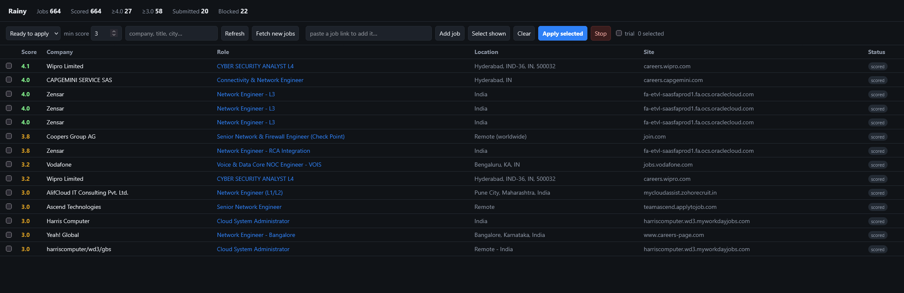

# Rainy

**A local job-search and application assistant for Windows.** It scores hundreds of postings against your CV and fills
the employer's own application form in a real browser — you approve every batch before anything is sent.

[](https://github.com/rainykarthick-crypto/rainy/actions/workflows/tests.yml)
[](https://github.com/rainykarthick-crypto/rainy/releases/latest)
[](LICENSE)
[]()



Rainy is a **remake of [AIHawk](https://github.com/feder-cr/Jobs_Applier_AI_Agent)** (MIT). AIHawk built the hard parts —
the job database, the browser automation, the form-filling model. This fork puts a dashboard on top, opens it to any
OpenAI-compatible model, encrypts the API key, and fixes the places where the browser used to stall.

---

## Download

| File | Size | Start | Get it |
|---|---|---|---|
| **Rainy.exe** | 87 MB | ~20 s | [single file, nothing else needed](https://github.com/rainykarthick-crypto/rainy/releases/latest/download/Rainy.exe) |
| **Rainy-1.0.0-win64.zip** | 87 MB | ~9 s | [extract, run `Rainy\Rainy.exe`](https://github.com/rainykarthick-crypto/rainy/releases/download/v1.0.0/Rainy-1.0.0-win64.zip) |

Windows 10/11, x64. Unsigned, so SmartScreen warns once: **More info → Run anyway**.

```powershell
Rainy.exe              # dashboard, opens in your browser
Rainy.exe --tui        # the terminal interface
Rainy.exe --install    # copy to %LOCALAPPDATA%\Programs\Rainy and add shortcuts
```

---

## Up and running in five steps

| | |
|---|---|
| **1. Start Rainy** | The dashboard opens at `http://127.0.0.1:8765` |
| **2. Paste an API key** | Checked against the gateway, then sealed with Windows DPAPI — only your Windows account can read it |
| **3. Upload your CV** | The search plan — titles, places, weights — is built from it |
| **4. Fill in your details** | Salary, notice period, address, education, work history: what every form asks for |
| **5. Fetch new jobs** | Then select and apply. Tick **trial** first to fill forms without sending |

---

## What it does

| Feature | |
|---|---|
| **Scored job list** | Every posting ranked 1–5 against your CV, filtered by score, status and text |
| **Batch apply** | Select a page, apply, watch each step live, stop between applications |
| **Trial mode** | Fills every required field and stops at the send button |
| **Resume upload** | PDF, Word or text; the search is rebuilt from your CV |
| **Editable answers** | Every detail the forms receive, changed in place, used by the next application |
| **Encrypted key** | Validated before saving, sealed with DPAPI, never displayed |
| **Chat** | Ask about your search; it answers from your live jobs and answers |
| **Add by link** | Paste a company job URL — read, scored, added to the list |
| **Fetch new jobs** | Sync the database, search again, score what is new |

## How it works

1. **Search.** A database of postings from 37 public sources, built by AIHawk's pipeline, is downloaded to your
   computer and searched locally — nothing about your search leaves the machine.
2. **Score.** A model reads each posting against your CV and says how sure it is that the job fits. That certainty is
   the score.
3. **Fill.** A model drives a real Firefox on the employer's form and fills every required field from your CV and
   answers, including the CV upload and voluntary disclosures.
4. **You send.** Nothing is submitted until you select the jobs and confirm the batch. Each outcome is recorded with a
   screenshot of what the page said.

## Configuration

Settings live in `%USERPROFILE%\.aihawk\aihawk.yaml`; see [configuration](docs/configuration.md). The gateway and models:

```yaml
base_url: https://api.deepseek.com/v1   # any OpenAI-compatible gateway
model: deepseek-flash                   # fills the forms; reads screenshots
quick_model: deepseek-flash             # short calls: the search plan
decision_model: deepseek-flash          # scores the postings
max_age_days: 30
```

Your CV, answers and application history stay in `%USERPROFILE%\.aihawk` on your computer. What leaves it is only what
the model is asked: your CV, your answers, and the text of the pages it fills.

## Known limits

- Windows x64 for the packaged builds — the browser engine has no Mac version
- LinkedIn postings are excluded from the database by design; paste the company's own application link instead
- A form that demands a profile photo cannot be completed — only the CV is uploaded
- The browser engine (~740 MB) downloads once, on the first application
- A captcha that is not a simple checkbox stops the form, and you finish that one by hand

## Development

```powershell
python -m venv .venv
.venv\Scripts\pip install -e ".[dev]"
.venv\Scripts\python -m pytest -m "not browser"    # 552 tests
.venv\Scripts\python dashboard.py                  # dashboard from source
```

`launcher.py` is what the packaged builds run: the dashboard by default, `--tui` for the terminal app, and
`--invisible-mcp` for the browser server it starts for itself when frozen into one file.

## Licence and credit

MIT, as AIHawk was. The original copyright notices stay in [LICENSE](LICENSE) and [NOTICE](NOTICE). Issues about the
job database or the browser engine belong upstream at
[feder-cr/Jobs_Applier_AI_Agent](https://github.com/feder-cr/Jobs_Applier_AI_Agent).
